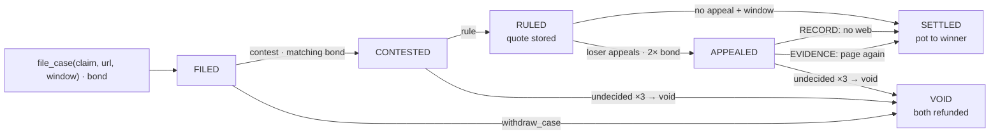

# Assize

**A court with two instances — and one of them never touches the web.**

Two people disagree about one sentence and one page. Each posts the same bond. The
first instance reads the page once, rules `SUSTAINED` or `REJECTED`, and must copy
the sentence it relied on.

The loser may appeal **once**, and must say on what ground:

- **RECORD** — "the ruling misread its own evidence". The second instance is given
  the claim, the ruling, and that quoted sentence, and it never fetches anything.
  Its only question is whether the quote, by itself, justifies the ruling.
- **EVIDENCE** — "the page was read wrongly". The second instance reads the page
  again, this time with the first ruling in front of it.

The appeal costs twice the case bond, so the pot grows and a frivolous second
instance is expensive. A ruling nobody appeals settles after its appeal window; an
appeal settles when the second instance answers. The winner takes the pot either
way, and a judgement nobody could ground moves nothing and can always be voided.

## Why it is a different model

Three things here are not in the usual "an AI judges a page" contract:

- **The appeal is a different question, not a second opinion.** A `RECORD` appeal
  asks whether the *decision taken from a quote* follows from that quote. No web
  access at all — so a page that changed since the ruling cannot reach it, and the
  second instance cannot be argued with by rewriting the page.
- **Two instances, one appeal, then final.** The loser chooses which question the
  court answers next, and the bond says how much that choice is worth.
- **A first instance that never rules costs nobody anything.** If the committee
  cannot ground a ruling, it books an attempt, moves no money, and after three of
  those *anyone* may void the case — both stakes go back to their own parties.

## Live on GenLayer Studio

`deployment.json` is the single source of truth: the **Deploy Contract** workflow
deploys the court once, writes the file, and commits it back to `main`.

| | |
|---|---|
| **Contract** | see `deployment.json` — written by the Deploy Contract workflow |
| **Network** | GenLayer Studio — chainId `61999` (`0xf22f`), test GEN only |
| **Evidence** | [Actions](https://github.com/weels007/genlayer-assize/actions) — direct, Studio, money paths, every deployment |

## Lifecycle



## How a ruling is produced

| Step | What happens |
|---|---|
| **File** | A claim (10–400 chars), an `https` page, a bond of at least `MIN_BOND`, and a caller-scoped reference so a replay cannot mint a second case. |
| **Contest** | A different account posts the same bond. No model is involved. |
| **Rule** | Permissionless. The page is fetched once inside a non-deterministic block, capped at `MAX_PAGE_CHARS`; the model answers `SUSTAINED`, `REJECTED` or `SILENT` with a verbatim quote. |
| **Ground** | The quote must appear in the page after folding to letters and digits. A ruling whose quote cannot be grounded is not a ruling. |
| **Consensus** | Validators re-run the same instance and must produce the same `ruling` (or the same `decision` for an appeal). |
| **Settle** | The winner takes `bond × 2` plus `bond × 2` more if there was an appeal. |

### Error taxonomy

| Tag | Meaning | Consensus behaviour |
|---|---|---|
| `[EXPECTED]` | bad input, wrong caller, wrong stake, a case in the wrong state | deterministic, must match |
| `[EXTERNAL]` | the page is empty | deterministic, recorded |
| `[TRANSIENT]` | network / 5xx, page unreachable | both transient means agreement, retry |
| `[LLM_ERROR]` | malformed choice, ungrounded quote | always disagrees → new leader |

## Money rules

- **`file_case` and `contest` never revert once value is attached.** A refused
  call — bond below the floor, a bad URL, a duplicate reference, a stake that does
  not match, a self-contest, a closed case, a bad ground, an appeal after the
  window, an appeal by the winner — becomes a **credit** owned by the sender,
  withdrawable with `withdraw_credit`.
- **The loser is the only one who may appeal**, and only inside the window.
- **`void` pays every party its own money back** — the bond, the contestant's
  stake, and the appeal stake if there was one.
- **`withdraw_case`** returns the bond of a filing nobody contested.
- **The ledger is updated first and the transfer last**, so a failed transfer
  rolls both back together.

Invariant: `total_in == total_out + locked_total`, credits included.

## Contract API

**Write**

| Method | Who | Purpose |
|---|---|---|
| `file_case(claim, source_url, appeal_window, case_ref)` · payable | anyone | open a case with a bond |
| `contest(case_id)` · payable | anyone but the filer | take the other side |
| `rule(case_id)` | anyone | first instance: read the page and rule |
| `appeal(case_id, ground)` · payable | the loser only | ask the second instance, `RECORD` or `EVIDENCE` |
| `judge_appeal(case_id)` | anyone | second instance: record only, or the page again |
| `settle(case_id)` | anyone | pay the pot to the winner |
| `void(case_id)` | anyone | refund everybody when nothing could be decided |
| `withdraw_case(case_id)` | the filer | take back an uncontested filing |
| `withdraw_credit()` | anyone with a credit | take back money from a refused call |

**View**

| Method | Returns |
|---|---|
| `get_case(id)` · `get_cases()` · `get_case_ids()` | a case, all cases, the id list |
| `is_contested(id)` · `can_appeal(id)` | whether a case has two sides, whether the window is still open |
| `get_credit(address)` · `get_ledger()` · `get_balance()` | credits, `total_in`, `total_out`, `locked_total`, real balance |
| `get_summary()` · `get_rules()` | counters, and the bounds the contract enforces |

## Security review

| Risk | How Assize answers it |
|---|---|
| A second instance that just asks the model again | `RECORD` runs on the claim, the ruling and the quote only, with no web access, so it cannot be moved by rewriting the page. The direct suite proves it runs with no page handler at all. |
| Stored text steering a later decision without consensus | The compared fields are `ruling` and `decision`. Quotes, reasons and digests are descriptive and no later call reads them as a decision. |
| An ungrounded citation deciding a case | A ruling without a quote taken from the page becomes undecided, which moves nothing. |
| The loser could stall forever | `settle` is permissionless after the window, and `void` is permissionless once the attempts are spent. |
| One side taking the other's money | Every payout goes to the stored party: the filer, the contestant, or the appellant. A stranger's `withdraw_case` is refused as `not_filer`. |
| The pot growing unbounded | One appeal only; the second instance is final. |
| Caller text manipulating the judge | Claim and page are framed as untrusted data, and instructions inside either are explicitly ignored. |
| Replay minting a second case | The reference is caller-scoped and recorded once. |
| SSRF through the URL | `https` only, no IP literal, no single-label host, no metadata aliases, alphabetic TLD. |
| Unbounded work | 500 cases, three attempts per instance, capped strings, O(1) summary. |

Residual risks, stated plainly:

- **`RECORD` judges entailment, not truth.** It can uphold a ruling whose quote is
  sincere but incomplete. That is the price of a second instance that never reads
  the web, and the reason the ground is recorded on-chain.
- A page can change between the filing and the ruling. The digest is stored so a
  reader can see what was read, but validators do not compare a live page.
- A `SILENT` page makes both parties wait: three attempts, then a void.

## Testing

| Suite | What it covers | Run |
|---|---|---|
| **Direct** | filing, contesting, both instances, all grounds, the loser rule, the window, credits, voids and the ledger invariant | `pytest tests/direct -v` |
| **Studio** | the deployed court: a real filing, a real contest, a live ruling, a live appeal and the settlement | `pytest tests/integration -v -s` |
| **End to end** | the money paths without a model: mismatched stake, self-contest, withdrawal of a filing, a contested case, an unearned void, and a stranger | `pytest tests/e2e -v -s` |

Every assertion in the live suites is a delta, and every claim reference carries
the run's start time, so they can be re-run against the same court.

## Quick start

```bash
pip install -r requirements.txt

genvm-lint check contracts/Assize.py   # forbidden imports, storage, nondet misuse
pytest tests/direct -v                 # the whole court, in memory, milliseconds
pytest tests/integration -v -s         # the deployed court, live
pytest tests/e2e -v -s                 # the deployed court's money paths

python scripts/deploy.py               # deploy once, record deployment.json
```

The direct suite mocks the page and the model; both instances, both grounds, the
window, every refund and the loser rule are exercised in memory.

The live suites sign with throwaway Studio accounts that the repository keeps in
Actions secrets — one filer and one contestant — so no key material is committed.

## Layout

```text
contracts/Assize.py              the court
tests/direct/                    filing, ruling, appeal, views
tests/integration/               the deployed court, live
tests/e2e/                       the deployed court's money paths
scripts/deploy.py                deploys once, records deployment.json
scripts/wallet.py                keystore from tests/ or a repository secret
deployment.json                  the deployed address (written by the workflow)
.github/workflows/               ci, integration, e2e, deploy-contract
```

## License

[MIT](LICENSE).
